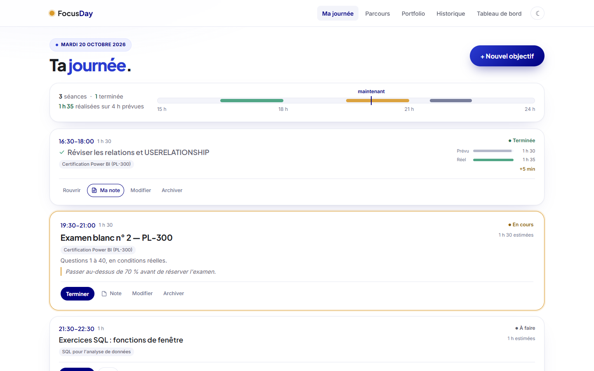
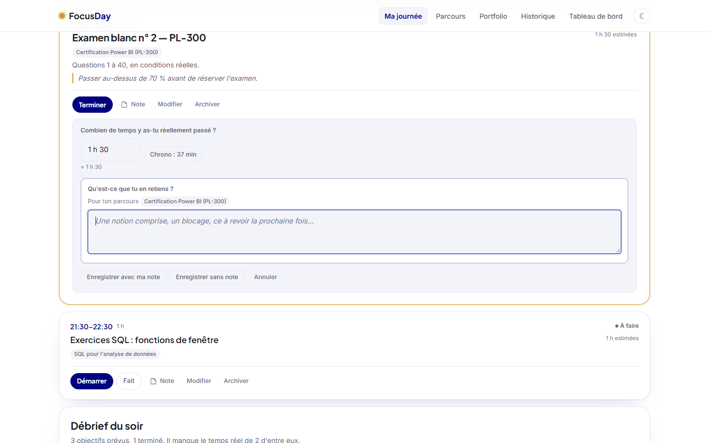
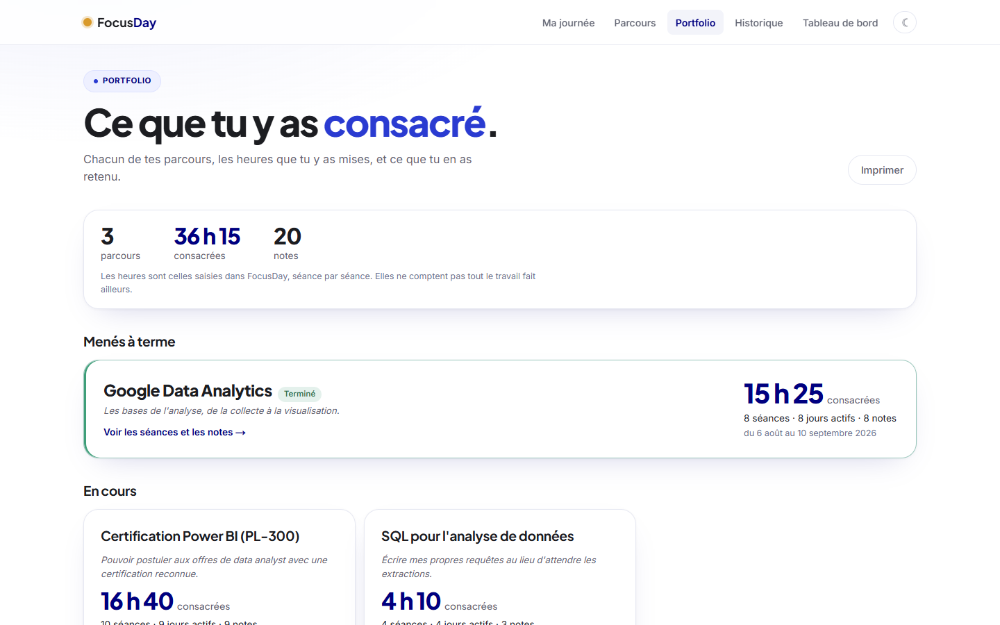
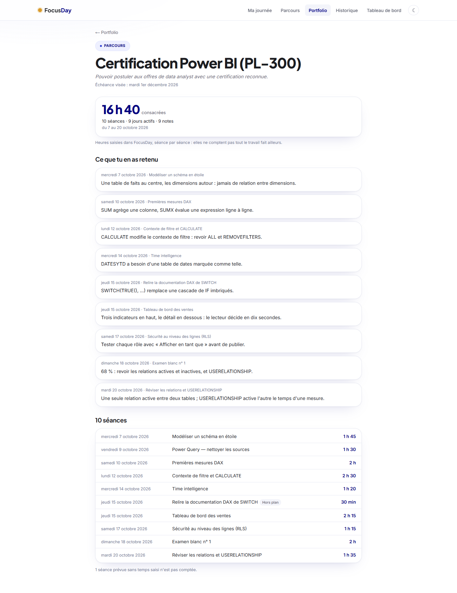
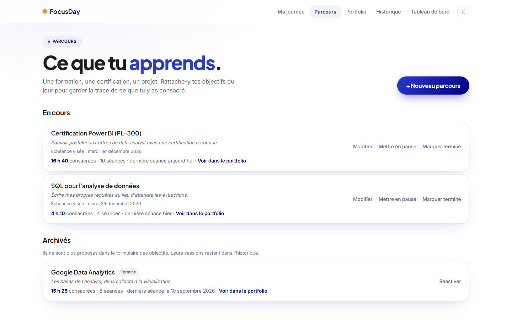
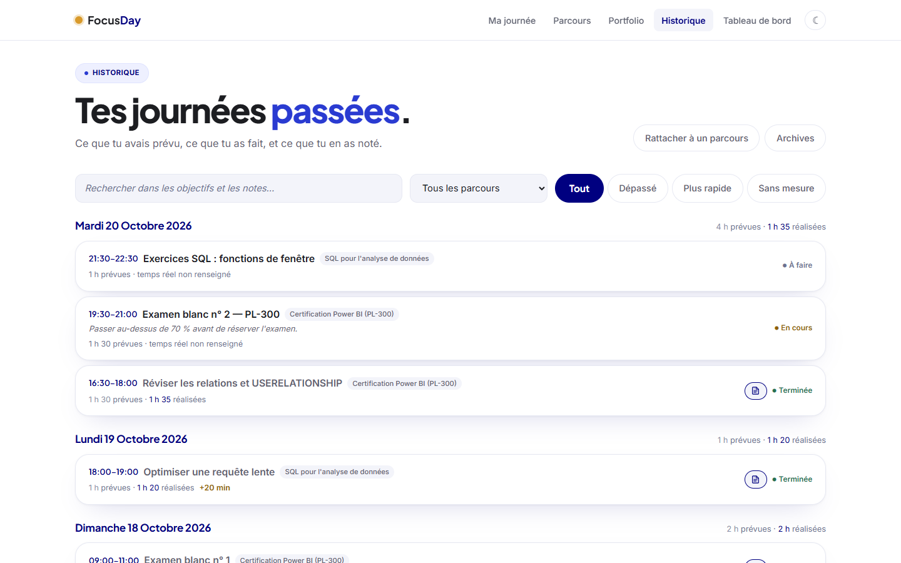
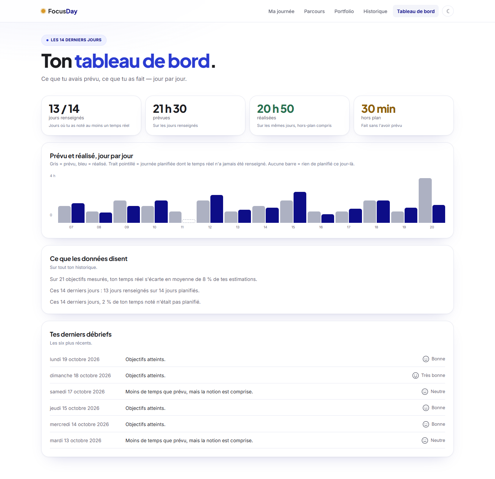
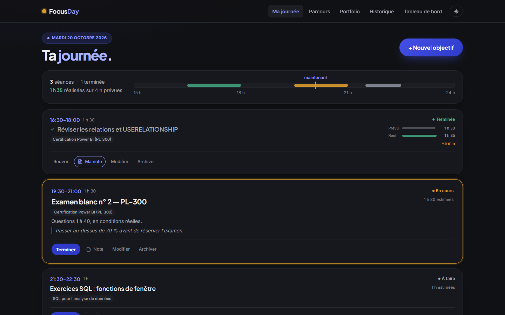
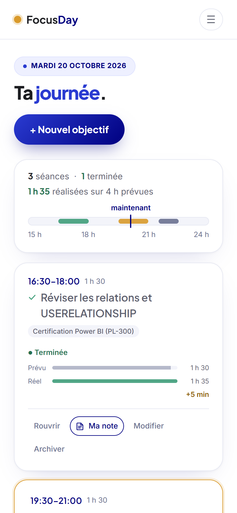
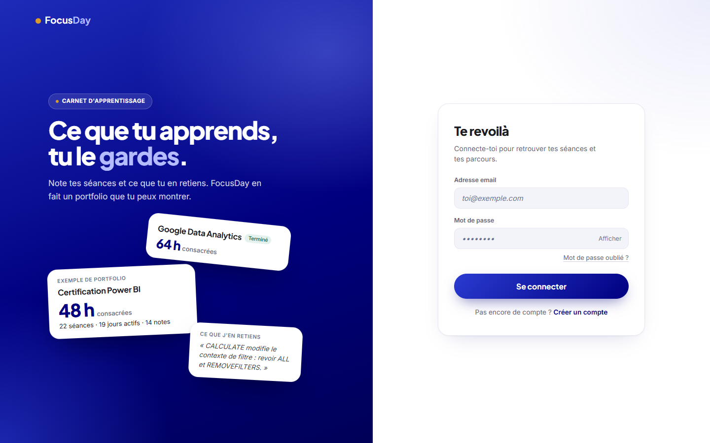

# FocusDay — ce que tu apprends, tu le gardes

**Un carnet d'apprentissage pour les personnes qui se forment seules** (certifications, bootcamps, MOOC). On planifie ses séances, on note le temps vraiment passé et ce qu'on en retient. FocusDay en fait un **portfolio** par parcours : heures consacrées, séances, notes. Une trace concrète à montrer à un recruteur.

**[focus-day-nps.vercel.app](https://focus-day-nps.vercel.app/)** (inscription par email)



> **Statut — pré-lancement.** L'application est en ligne et utilisée au quotidien. La phase de mesure s'est terminée le 2 novembre 2026 : poser la question « Qu'est-ce que tu en retiens ? » au moment de valider une séance fait passer les notes de 7 % à 54,5 % des séances rattachées à un parcours (6 sur 11). L'échantillon est petit, une seule utilisatrice sur deux semaines, mais l'effet est net : le mécanisme est gardé ([`docs/BRIEF-PIVOT.md`](docs/BRIEF-PIVOT.md)). La liste de ce qui reste à faire avant d'ouvrir à un groupe est tenue dans [`docs/PRE-LANCEMENT.md`](docs/PRE-LANCEMENT.md).
>
> Les captures de ce README utilisent un **jeu de données fictif**.

---

## Le problème

Quand on prépare une certification seul, le travail ne laisse aucune trace. Des dizaines d'heures de vidéos, d'exercices et d'examens blancs, et au bout, une ligne sur un CV. On ne sait plus combien de temps on y a vraiment passé, ni ce qu'on a appris à chaque séance.

FocusDay part de trois gestes simples :

1. **Planifier une séance** : un créneau, rattaché à un parcours (« Certification Power BI »).
2. **La valider** : le temps réellement passé, pas celui prévu.
3. **Noter ce qu'on en retient**, en une phrase.

Le reste se construit tout seul : le portfolio du parcours, l'historique et le tableau de bord.

---

## Aperçu

### Valider une séance et noter ce qu'on en retient

La validation demande le temps réel, puis la note. Les deux choix sont explicites (« Enregistrer avec ma note » / « Enregistrer sans note ») : passer la note est possible, mais jamais par défaut.



### Le portfolio

Pour chaque parcours : les heures **consacrées**, le nombre de séances et de jours actifs, et toutes les notes. Les parcours terminés sont mis en avant, et la page s'imprime proprement.

| Vue d'ensemble | Un parcours en détail |
| :---: | :---: |
|  |  |

### Parcours, historique, tableau de bord

| Parcours | Historique |
| :---: | :---: |
|  |  |

Le tableau de bord compare le prévu et le réalisé jour par jour, sur deux semaines. Il refuse de conclure quand les données sont trop minces, et il signale un temps réel suspect, recopié de l'estimation.



### Thème sombre, mobile, connexion

| Thème sombre | Mobile |
| :---: | :---: |
|  |  |



---

## Fonctionnalités

- **Ma journée** : créneaux horaires, statuts calculés selon l'heure (à faire, en cours, terminée, manquée), ruban de la journée avec repère « maintenant », rappels par notification du navigateur.
- **Validation en deux temps** : temps réel (avec chronomètre si la séance a été démarrée), puis « Qu'est-ce que tu en retiens ? ».
- **Rattrapage du soir** : les séances non validées, une activité faite hors plan, et un débrief (objectifs atteints, ressenti, ce qui a manqué).
- **Parcours** : une formation, une certification ou un projet, avec sa raison d'être et son échéance. On peut le mettre en pause ou le marquer terminé.
- **Portfolio** : heures consacrées, séances, jours actifs, notes, période couverte. Version imprimable.
- **Historique** : recherche dans les titres et les notes, filtres (dépassé, plus rapide, sans mesure), rattachement par lot des anciennes séances à un parcours.
- **Tableau de bord** : prévu et réalisé sur 14 jours, part du hors-plan, lecture des écarts d'estimation.
- **Comptes** : inscription avec confirmation par email, mot de passe oublié, emails en français. Chaque utilisateur ne voit que ses données.
- **Thème clair et sombre**, mise en page adaptée au mobile.

---

## Choix techniques

| | |
|---|---|
| **Front** | Next.js 16 (App Router, Turbopack), React 19, TypeScript strict, Tailwind CSS v4 |
| **Données** | Supabase : Postgres, Auth, Row Level Security |
| **Emails** | SMTP Brevo, modèles HTML en français ([`supabase/emails/`](supabase/emails)) |
| **Qualité** | Vitest (109 tests unitaires), ESLint, GitHub Actions |
| **Déploiement** | Vercel |

Ce qui mérite d'être raconté :

- **Une couche d'accès aux données interchangeable.** Toute l'interface parle à une interface `Repo` ([`lib/repo.ts`](lib/repo.ts)). Deux implémentations existent : `localStorage` pour le développement, Supabase en production. On bascule avec une seule variable d'environnement, sans toucher aux composants.
- **La sécurité dans la base, pas dans le code.** Chaque table du schéma public a la RLS activée, avec une politique « propriétaire seulement ». La clé exposée au navigateur est la clé publique ; la clé de service n'est utilisée nulle part côté client.
- **Des écritures ciblées.** Modifier une séance envoie un `UPDATE` des seules colonnes changées, en un aller-retour ([`lib/sessionPatch.ts`](lib/sessionPatch.ts)), jamais une réécriture de la ligne entière depuis la copie du navigateur. Une ligne non modifiée (supprimée ailleurs, ou filtrée par la RLS) remonte comme une erreur, pas comme un succès silencieux.
- **Des mises à jour optimistes qui savent reculer.** L'écran change tout de suite. Si l'écriture échoue, l'état précédent est restauré et un bandeau dit précisément ce qui n'a pas été enregistré. Quitter la page pendant une écriture déclenche un avertissement.
- **Des erreurs visibles et traduites.** Chaque échec de lecture ou d'écriture a son bandeau, avec « Réessayer ». Les messages de Supabase sont traduits en phrases qui disent quoi faire. Un refus de jeton connu (`PGRST303`, juste après la connexion) est réessayé une seule fois, automatiquement.
- **L'instrumentation de la mesure.** Chaque séance enregistre par quel chemin son temps réel a été saisi (`actual_source` : panneau, rattrapage ou hors plan). On peut ainsi comparer les taux de notes entre variantes ([`supabase/mesures/`](supabase/mesures)).
- **Les migrations avant le code.** Chaque changement de schéma est un fichier SQL séparé, appliqué en production avant le déploiement du code qui en dépend, avec un contrôle préalable qui s'arrête proprement si une ligne existante ne passe pas. Le schéma de référence ([`supabase/schema.sql`](supabase/schema.sql)) est un dump de la production, versionné.
- **Des limites partout, et visibles.** Chaque champ texte est borné en base et dans le formulaire ([`lib/limits.ts`](lib/limits.ts)). Un compteur apparaît à l'approche de la limite, pour qu'aucune saisie ne soit coupée sans prévenir.

---

## Organisation du code

```text
app/                  Pages (App Router) : Ma journée, parcours, portfolio,
                      historique, tableau de bord, archives, connexion
  auth/callback/      Retour des liens envoyés par email
components/           Composants d'interface (carte de séance, panneau de
                      validation, débrief, bande du jour…)
lib/
  repo.ts             Interface Repo + implémentation localStorage
  repo.supabase.ts    Implémentation Supabase
  useTasks.ts         État de la journée : écritures optimistes, restauration
  time.ts             Logique temporelle (créneaux, minuit, statuts)
  portfolio.ts        Agrégats du portfolio
  lecture.ts          Lecture prudente des écarts d'estimation
  *.test.ts           Tests unitaires (Vitest)
supabase/
  schema.sql          Schéma de référence, dump de la production
  0X_*.sql            Migrations, appliquées avant le code
  emails/             Modèles d'emails en français
  mesures/            Requêtes de la phase de mesure
  sauvegarde/         Copie datée de toutes les tables
docs/                 Brief produit, reprise du projet, liste de pré-lancement
proxy.ts              Rafraîchit la session, protège les pages
```

---

## Lancer le projet

```bash
npm install
npm run dev
```

L'application tourne alors sur `http://localhost:3000`. Sans configuration, elle stocke les données dans le navigateur (`localStorage`).

Pour la brancher sur Supabase, créer un fichier `.env.local` (jamais versionné) avec :

```text
NEXT_PUBLIC_DATA_SOURCE=supabase
NEXT_PUBLIC_SUPABASE_URL=…
NEXT_PUBLIC_SUPABASE_ANON_KEY=…   # clé publique uniquement
```

Les quatre vérifications, lancées aussi par la CI à chaque push :

```bash
npm run lint
npx tsc --noEmit
npm test
npm run build
```

---

## Feuille de route

Fait à la fin de la phase de mesure (2 novembre 2026) :

- le temps réel n'est plus prérempli avec l'estimation : le champ est vide, le prévu s'affiche en indication ;
- un seul chemin de validation par séance, selon son statut : la carte pour une séance à venir ou en cours, le rattrapage du soir pour une séance manquée ;
- une estimation demandée explicitement pour les créneaux de plus de 4 heures.

Prévu :

- une page « Ma journée » recentrée sur la séance en cours, débrief replié ;
- export planifié des sauvegardes hors de Supabase ;
- suppression de compte et export des données par l'utilisateur.

---

## Origine

FocusDay prolonge un sujet d'examen de Master 1 (2025) : une todo-list en Flutter, PHP et MySQL. Repris en 2026, il est devenu un outil de suivi par créneaux horaires, puis, après un pivot, un carnet d'apprentissage centré sur ce qu'on retient de chaque séance.

---

## Autrice

Conçu et développé par **Ndeye Penda Sarr**, Business Intelligence & Data · Développement web full-stack.

© 2025–2026 Ndeye Penda Sarr
